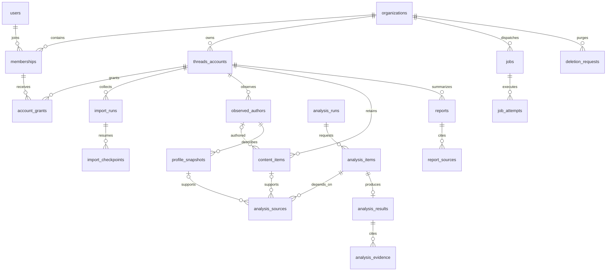

# Database design

Status: logical target design for MariaDB 10.11; Phase 1 identity/audit and Phase 2 synthetic queue/privacy subsets implemented. Local execution used MariaDB 12.3.3; 10.11 execution remains unverified.

Phase 3A design update (25 October 2026): no schema or migration changed. Future account/credential/capability, request reservation, source version and real-data suppression contracts are refined in [PHASE3A_INTEGRATION_DESIGN.md](PHASE3A_INTEGRATION_DESIGN.md). Author observations must not assume a stable provider author ID or become individual interest profiles. Current logical discovery/analysis tables remain gated proposals under [PHASE3A_DECISION_REPORT.md](PHASE3A_DECISION_REPORT.md); Phase 3B is unapproved.
Planning date: 24 October 2026.

## Implemented Phase 2 boundary (25 October 2026)

The original six SQL migrations are unchanged. Nine additive one-statement migrations, `0007`–`0015`, create `privacy_scopes`, `jobs`, `job_attempts`, `worker_runs`, `scheduled_tasks`, `retention_policies`, `deletion_requests`, `demo_effects` and `private_files`. Their actual SQL checks/indexes/FKs are authoritative; the conceptual tables below are future design. The existing organization privacy epoch remains canonical; synthetic deletion updates it, data version and the scope mirror/block atomically. This blocks demo workload without disabling administrator health/login. Child attempts/effects have composite organization/job FKs. Files carry opaque keys, ready state, epoch and expiry. Jobs contain no account/source/parent references before their real parents exist, and payloads reject those fields. `dispatch_key` implements the proposed idempotency key; `finished_at` is completion time and errors are allowlisted codes.

Clean fifteen-migration installation, six-to-fifteen upgrade and rerun were exercised on MariaDB 12.3.3 only. The runner now records phase-2 release metadata; old applied history stays intact. Minimal suppression/deletion state persists beyond ordinary logs to prevent restore replay. Provider budgets/request controls, account/source suppression and report manifests await their modules. See [QUEUE_ARCHITECTURE.md](QUEUE_ARCHITECTURE.md), [PRIVACY_RETENTION.md](PRIVACY_RETENTION.md) and [CRON_SETUP.md](CRON_SETUP.md) for implementation differences, DDL recovery and rollback compatibility. The Phase 1 paragraph below is historical.

## Implemented Phase 1 boundary

At the historical Phase 1 checkpoint, six migrations created `organizations`, `users`, `memberships`, `auth_sessions`, `login_throttles` and `audit_events`, plus the runner-owned registry. The SQL files are unchanged. Only one administrator/organization can be provisioned; sessions have a composite membership FK. Phase 2 now adds the tables listed above. Invitations, reset tokens, account grants, OAuth, content and analysis remain unimplemented. See [PHASE1_COMPLETION_REPORT.md](PHASE1_COMPLETION_REPORT.md) for the earlier evidence.

## 1. Conventions and integrity rules

Use InnoDB, `utf8mb4` for user content, a documented case-insensitive collation for search/display text, and binary/case-sensitive collation for opaque provider identifiers. Internal keys are `BIGINT UNSIGNED`. Remote IDs are `VARCHAR(191)` strings, never numeric PHP values; API IDs may exceed safe numeric ranges. Cryptographic hashes are `BINARY(32)`; random secret digests use the same size. Currency amounts use `DECIMAL(16,8)` plus currency code, never float. Times use UTC `DATETIME(6)`; application and PDO connections set UTC. Use explicit nullability, finite text/JSON sizes and check constraints.

Notation: `PK` primary key, `FK` foreign key, `UQ` unique constraint, `IX` secondary index, `?` nullable. Every non-global business table has `organization_id`. Unless stated otherwise it also has `id PK`, `created_at` and `updated_at`. Membership/link tables can use the stated composite PK instead. Status/type strings are bounded `VARCHAR` values with checks and PHP enums rather than MariaDB ENUMs that require schema alteration for every new state.

Every tenant parent exposes `UQ(organization_id,id)`. A child references `(organization_id,parent_id)`, not `parent_id` alone. Account-scoped parents additionally expose `UQ(organization_id,threads_account_id,id)` where needed, and their children use that composite FK. Membership/grant foreign keys enforce the same organization. This prevents accidental cross-tenant or cross-account joins even when application code has a bug. All reads still require scoped authorization; foreign keys do not replace it.

Large payloads use MariaDB JSON only for bounded metadata/configuration, with JSON validity and application schema validation. Frequently filtered values have typed columns/indexes; do not query the entire corpus through JSON scans. Do not store complete provider responses, duplicate raw prompts, credentials in queue JSON, or token-bearing URLs. JSON limits and legal nullable relationships must be included in future migrations.

Hard deletion is the eventual privacy action. A `blocked_at`/tombstone is an immediate access control during purge, not an indefinite soft-delete archive. Standard FK delete behavior is RESTRICT to force an explicit ordered purge. Small non-sensitive linking rows may use CASCADE when bounded and documented; do not depend on a massive cascade fitting a cron budget.

Historical actor/requester references are nullable global-user FKs with SET NULL on an approved user purge; verify organization membership at action time, but do not make historical records depend on a membership remaining active forever. Current access grants use membership FKs and are removed on membership deletion. De-identify historical attribution according to its retention policy rather than retaining an otherwise deletable user solely to satisfy a foreign key.

## 2. Entity relationships

Content is unified so a reply returned by multiple endpoints has one identity. Public-post samples share storage but are distinguished by type and are never included in owned-post reply metrics accidentally.

## 3. Identity and access tables

| Table | Fields and relationships | Keys / lifecycle |
| --- | --- | --- |
| `organizations` | `id`, `name VARCHAR(160)`, `slug VARCHAR(100)`, `status`, `display_timezone VARCHAR(64)`, `privacy_epoch BIGINT`, `data_version BIGINT`, `blocked_at?`, `created_at`, `updated_at` | UQ slug; status active/blocked/deleting; timezone validated as IANA |
| `users` (global) | `id`, normalized `email VARCHAR(254)`, `display_name VARCHAR(160)`, `password_hash VARCHAR(255)`, `status`, `is_installation_admin BOOL`, `session_version BIGINT`, `last_login_at?`, timestamps | UQ email; admin role does not imply tenant content access |
| `memberships` | `organization_id FK`, `user_id FK`, `role`, `status`, `joined_at`, timestamps | PK `(organization_id,user_id)`; roles owner/analyst/viewer; IX `(user_id,status)` |
| `account_grants` | `organization_id`, `threads_account_id FK`, `user_id`, `access_level`, `granted_by_user_id`, timestamps | PK `(organization_id,threads_account_id,user_id)`; FKs to membership and account; read or analyze access, bounded by membership role; IX `(organization_id,user_id,threads_account_id)` |
| `one_time_tokens` | `organization_id`, `purpose`, `token_hash`, `target_email?`, `target_user_id?`, `invited_role?`, `created_by_user_id?`, `expires_at`, `consumed_at?` | UQ token hash; purpose invite or password_reset; purpose-specific checks; IX expiry; hash only, tenanted reset flow |
| `auth_sessions` (global) | `id`, `user_id FK`, `session_id_hash`, `session_version`, `created_at`, `last_seen_at`, `absolute_expires_at`, `revoked_at?` | UQ session hash; IX `(user_id,revoked_at)` and expiry; PHP payload in private session files with matching TTL/garbage collection |
| `login_throttles` (global) | `id`, `bucket_hash`, `bucket_kind`, `window_started_at`, `attempt_count`, `blocked_until?`, `expires_at` | UQ `(bucket_hash,bucket_kind,window_started_at)`; IX expiry; keyed hashes for email/IP buckets; no raw passwords or permanent IP log |
| `oauth_states` | `organization_id`, `user_id` membership FK, `state_hash`, `operation`, `target_account_id?`, `redirect_uri_key`, `expires_at`, `consumed_at?` | UQ state hash; target account composite FK if present; IX expiry; exact callback URI from configuration |

Owner membership implicitly grants management of organization accounts; other roles need account grants. Every action evaluates the role/action matrix as well as a grant. Removing a membership invalidates grants/sessions for that context. Protect the last active organization owner from accidental removal in a locked transaction.

## 4. Threads credentials and provider controls

| Table | Fields and relationships | Keys / lifecycle |
| --- | --- | --- |
| `threads_accounts` | `organization_id`, `remote_user_id`, `username?`, `display_name?`, `connected_by_user_id`, `status`, `token_expires_at?`, `token_generation BIGINT`, `last_sync_at?`, `last_refresh_at?`, `privacy_epoch`, `data_version`, `blocked_at?` | UQ `(organization_id,remote_user_id)`; IX `(status,token_expires_at)` for scheduler; account status pending/active/reconnect_required/disabled/deleting |
| `threads_credentials` | `organization_id`, `threads_account_id FK`, `token_ciphertext BLOB`, `nonce VARBINARY`, `key_id VARCHAR(64)`, `algorithm`, `associated_data_version`, `token_generation` | UQ `(organization_id,threads_account_id)`; never store plaintext; nonce length enforced for chosen sodium algorithm; separately backed-up master key |
| `account_capabilities` | `organization_id`, `threads_account_id FK`, `capability`, `required_permission`, `grant_status`, `verification_status`, `verified_at?`, `grant_expires_at?`, `safe_failure_code?`, `api_version`, `policy_revision` | UQ `(organization_id,threads_account_id,capability)`; requested/granted/denied/expired is separate from verified/unverified/unsupported |
| `provider_limits` (global scoped control) | `id`, `provider`, `scope_kind`, `scope_key_hash`, `capability`, `window_started_at`, `window_ends_at`, `requests_used`, `tokens_reserved`, `cost_reserved`, `cost_used`, `currency`, `next_allowed_at?`, `usage_metadata_json?`, timestamps | UQ `(provider,scope_kind,scope_key_hash,capability,window_started_at)`; IX `(provider,next_allowed_at)`; scope kind app/organization/account; keys never contain tokens; budgets locked/reserved atomically |
| `provider_requests` | `organization_id`, `threads_account_id?`, `job_id?`, `analysis_item_id?`, `attempt_no`, `provider`, `operation`, `request_fingerprint`, `provider_request_id?`, `status`, `http_status?`, `safe_error_code?`, `reserved_cost`, `actual_cost?`, `currency`, `input_tokens?`, `output_tokens?`, `started_at`, `finished_at?`, `expires_at` | UQ `(organization_id,job_id,attempt_no,provider,operation)` for job-bound calls; separate OAuth calls have nullable job and unique internal request ID; IX `(organization_id,provider,started_at)` and expiry |

`provider_limits` contains no content and is accessible only to the provider-budget service. All its tenant-bound operations derive the scope hash from authorized context. Apply both shared app and local tenant/account constraints as appropriate. An unknown outbound outcome keeps a conservative cost reservation until reconciliation/manual review; resetting a budget period must not silently discard unresolved spend.

External OpenAI credentials initially live in private installation configuration; no UI for arbitrary key storage is required. If tenant-managed keys are later approved, use a separate encrypted credential store with the same key-rotation controls. Capability flags are evidence-backed feature gates, not user-editable claims of provider approval.

## 5. Collection and audience tables

| Table | Fields and relationships | Keys / lifecycle |
| --- | --- | --- |
| `import_runs` | `organization_id`, `threads_account_id FK`, `requested_by_user_id`, `kind`, `requested_since?`, `requested_until?`, `selection_json`, `retrieval_mode`, `status`, `api_version`, `capability_snapshot_json`, `policy_revision`, `pages_committed`, `objects_seen`, `started_at?`, `finished_at?`, `safe_error_code?`, `expires_at` | IX `(organization_id,threads_account_id,created_at)`; selected IDs are bounded and ownership-validated; no arbitrary external targets |
| `import_checkpoints` | `organization_id`, `threads_account_id`, `import_run_id FK`, `stream_key_hash`, `root_remote_id?`, `endpoint_kind`, `cursor_ciphertext?`, `cursor_nonce?`, `key_id?`, `pass_no`, `page_no`, `last_remote_timestamp?`, `status`, `version BIGINT` | UQ `(organization_id,import_run_id,stream_key_hash,pass_no)`; IX `(organization_id,import_run_id,status)`; encrypted cursor only, never full next URL |
| `observed_authors` | `organization_id`, `threads_account_id FK`, `identity_kind`, `identity_key_hash`, `remote_author_id?`, `observed_username?`, `handle_observation_epoch?`, `identity_quality`, `first_seen_at`, `last_seen_at`, `blocked_at?`, `privacy_epoch`, `expires_at` | UQ `(organization_id,threads_account_id,identity_kind,identity_key_hash)`; IX account/last_seen and expiry; stable_id or observed_handle kinds; no global people directory |
| `content_items` | `organization_id`, `threads_account_id FK`, `remote_thread_id`, `kind`, `observed_author_id? FK`, `root_remote_id?`, `parent_remote_id?`, `text MEDIUMTEXT?`, `permalink?`, `media_type?`, `published_at?`, `first_collected_at`, `last_verified_at?`, `content_hash`, `source_version BIGINT`, `visibility_status`, `text_status`, `is_owner_authored? BOOL`, `blocked_at?`, `expires_at` | UQ `(organization_id,threads_account_id,remote_thread_id)`; IX `(organization_id,threads_account_id,kind,published_at,id)`, `(organization_id,threads_account_id,root_remote_id,id)`, `(organization_id,threads_account_id,observed_author_id,published_at)`, expiry |
| `profile_snapshots` | `organization_id`, `threads_account_id`, `observed_author_id FK`, `source_kind`, `username?`, `display_name?`, `biography TEXT?`, `profile_image_url?`, `fields_available_json`, `source_hash`, `source_version`, `capability_revision`, `collected_at`, `last_verified_at?`, `blocked_at?`, `expires_at` | UQ `(organization_id,threads_account_id,observed_author_id,source_kind)` for current retained snapshot; IX expiry; source kind own_profile or verified_public_discovery |
| `source_observations` | `organization_id`, `threads_account_id`, `content_item_id?`, `profile_snapshot_id?`, `import_run_id?`, `endpoint_kind`, `api_version`, `permission_snapshot_json`, `observed_source_version`, `observed_at`, `expires_at` | Exactly one content/profile target via CHECK and composite FKs; IX `(organization_id,content_item_id,observed_at)` and profile equivalent; no duplicate body; bounded observations retention |

`content_items.kind` is owned_post, reply or public_post_sample. The same remote ID cannot create two rows merely because two endpoints returned it. Imported ownership/parent/root facts are explicit; missing parents keep remote references without inventing local placeholder bodies. Applications verify a reply's root belongs to an authorized owned post. Public samples remain outside baseline root ownership flows.

Identity keys are keyed hashes of an actual stable author ID, or a normalized observed handle plus bounded observation epoch when a stable ID is absent. Usernames can change or be reused; handle-only observations are provisional and cannot be safely merged across time/account contexts. A profile lookup without a stable ID does not upgrade identity to verified personhood. A later stable ID can link observations only with provider evidence; update references and aggregates transactionally, never by name similarity. Unknown authors have null references and a separate unknown count. Do not assign one shared unknown-author record.

Keep a current retained source body and increment its version on content/context changes. Do not retain old raw versions by default. Provenance retains hashes/metadata only while permitted. Root/parent edits invalidate dependent analysis because input fingerprints include context versions. Expired sources remove their quotations from analysis and reports.

## 6. Analysis and topics tables

| Table | Fields and relationships | Keys / lifecycle |
| --- | --- | --- |
| `analysis_configs` | `organization_id`, `name`, `provider_model`, `prompt_version`, `schema_version`, `taxonomy_version`, `config_hash`, `parameters_json`, `approved_at?`, `approved_by_user_id?`, `enabled` | UQ `(organization_id,config_hash)`; immutable versions; prompt source remains in version control; parameters have bounded schema |
| `analysis_runs` | `organization_id`, `threads_account_id`, `analysis_config_id FK`, `requested_by_user_id`, `scope_json`, `stance_target TEXT?`, `status`, `estimated_items`, `completed_items`, `refused_items`, `failed_items`, `skipped_items`, `budget_amount`, `currency`, `policy_revision`, `started_at?`, `finished_at?`, `expires_at` | IX `(organization_id,threads_account_id,created_at)`; exact counters recomputable from run items |
| `analysis_items` | `organization_id`, `threads_account_id`, `analysis_config_id`, `primary_content_id?`, `primary_profile_id?`, `input_fingerprint`, `scope_privacy_epoch`, `source_privacy_epoch`, `target_hash`, `input_truncated BOOL`, `status`, `uncertainty_reason?`, `expires_at` | Exactly one primary target; UQ `(organization_id,threads_account_id,input_fingerprint)`; IX `(organization_id,status,id)` and expiry |
| `analysis_run_items` | `organization_id`, `threads_account_id`, `analysis_run_id FK`, `analysis_item_id FK`, `run_item_status`, `added_at` | PK `(organization_id,analysis_run_id,analysis_item_id)`; IX `(organization_id,analysis_item_id)`; allows safe reuse between runs without losing run denominators |
| `analysis_sources` | `organization_id`, `threads_account_id`, `analysis_item_id FK`, `content_item_id?`, `profile_snapshot_id?`, `expected_source_version`, `expected_source_hash`, `evidence_ref VARCHAR(64)`, `role` | Exactly one target; UQ `(organization_id,analysis_item_id,evidence_ref)`; IX content and profile targets for invalidation; role reply/root/parent/profile/public_sample |
| `analysis_results` | `organization_id`, `threads_account_id`, `analysis_item_id FK`, `sentiment?`, `stance?`, `style_labels_json`, `language_code?`, `uncertainty_reason?`, `summary TEXT?`, `validated_at`, `is_current BOOL`, `output_hash`, `expires_at` | UQ `(organization_id,analysis_item_id)`; IX `(organization_id,threads_account_id,is_current,sentiment)`; allowed enums; not-current rows excluded from metrics |
| `analysis_evidence` | `organization_id`, `threads_account_id`, `analysis_result_id FK`, `analysis_source_id FK`, `claim_key`, `excerpt TEXT`, `start_codepoint?`, `end_codepoint?`, `validation_status`, `expires_at` | Composite FKs keep result/source in same account; service verifies same analysis item and expected source version; IX `(organization_id,analysis_result_id)` |
| `analysis_corrections` | `organization_id`, `threads_account_id`, `analysis_result_id FK`, `corrected_by_user_id`, `field_name`, `corrected_value_json`, `reason TEXT?`, `supersedes_correction_id?`, `expires_at` | IX `(organization_id,analysis_result_id,field_name,id)`; immutable audit trail while source retained; latest correction applied through defined effective-result view/service |
| `topics` | `organization_id`, `taxonomy_version`, `topic_key VARCHAR(120)`, `display_label VARCHAR(160)`, `status` | UQ `(organization_id,taxonomy_version,topic_key)`; reviewed non-sensitive taxonomy; free topic candidates need validation/normalization |
| `result_topics` | `organization_id`, `threads_account_id`, `analysis_result_id FK`, `topic_id FK`, `analysis_evidence_id? FK` | PK `(organization_id,analysis_result_id,topic_id)`; IX `(organization_id,topic_id,analysis_result_id)`; evidence must belong to result; topic unique per reply/result |

The fingerprint is SHA-256 over canonical input/configuration: account scope, ordered source IDs/hashes/versions, truncation strategy, stance target, model and all prompt/schema/taxonomy/parameter versions. A raw reply hash alone is insufficient. New taxonomy, prompt, root context or correction policy invalidates relevant aggregates; do not overwrite model results with human corrections. Effective metrics disclose whether corrections were applied.

Status includes pending, processing, succeeded, refused, incomplete, invalid_output, skipped, blocked, failed and cancelled. Refused/failed/skipped are not sentiment categories. Model confidence is not stored as a calibrated probability; use explicit uncertainty/abstention. Style fields describe the supplied text. Reject personal-attribute labels even if a schema-valid model response proposes them.

## 7. Analytics and report tables

| Table | Fields and relationships | Keys / lifecycle |
| --- | --- | --- |
| `aggregate_versions` | `organization_id`, `threads_account_id`, `scope_hash`, `scope_json`, `analysis_config_id?`, `metric_definition_version`, `correction_policy_version`, `source_data_version`, `privacy_epoch`, `status`, `last_processed_id?`, `high_watermark_id?`, `started_at`, `completed_at?`, `is_active BOOL`, `expires_at` | IX `(organization_id,threads_account_id,scope_hash,status)`; active version chosen via locked pointer in account/scoped metadata, not by assuming BOOL is unique |
| `aggregate_buckets` | `organization_id`, `threads_account_id`, `aggregate_version_id FK`, `bucket_key_hash`, `metric_key`, `dimension_json`, `period_start?`, `numerator BIGINT`, `denominator? BIGINT`, `value_decimal?` | UQ `(organization_id,aggregate_version_id,bucket_key_hash)`; IX `(organization_id,aggregate_version_id,metric_key,period_start)`; no raw text or identifiers in dimensions |
| `aggregate_heads` | `organization_id`, `threads_account_id`, `scope_hash`, `active_version_id? FK`, `dirty_since?`, `privacy_epoch` | PK `(organization_id,threads_account_id,scope_hash)`; atomic pointer publication; version must match scope, checked in service transaction |
| `reports` | `organization_id`, `threads_account_id`, `requested_by_user_id`, `scope_json`, `scope_hash`, `analysis_config_id?`, `aggregate_version_id?`, `source_data_version`, `privacy_epoch`, `status`, `methodology_version`, `coverage_json`, `summary_json?`, `private_storage_key?`, `format`, `completed_at?`, `expires_at`, `blocked_at?` | IX `(organization_id,threads_account_id,created_at)` and expiry; format html/csv; storage key random and internal, not arbitrary filesystem path |
| `report_sources` | `organization_id`, `threads_account_id`, `report_id FK`, `content_item_id?`, `profile_snapshot_id?`, `analysis_item_id?`, `source_version`, `source_hash`, `evidence_ref`, `expires_at` | Exactly one content/profile source; optional analysis link; UQ `(organization_id,report_id,evidence_ref)`; reverse IX on content/profile to find dependent reports |

A complete aggregate scan requires stable input semantics. Capture account data_version and privacy_epoch when starting; if inputs change during a chunked scan, do not publish it as current. Rebuild or use a specifically defined fixed scope after checking versions. This avoids silently mixing old and new data across transactions. Initially limit scopes to account/date/post filters; distinct-author counts are computed over the complete filtered set, never by summing daily distinct counts.

Increment account data_version when source content, valid results, effective corrections or relevant visibility changes, not just on import. This makes new analysis and corrections invalidate existing aggregates too. Every narrower content/author deletion also increments the containing account privacy_epoch; account-level caches and report files then fail closed immediately while affected rows are purged. Normal additions can leave a previous safe aggregate visible with a stale badge; a privacy-epoch mismatch cannot.

Metrics use one effective current result per source/configuration. Multi-topic joins must use distinct reply IDs before counting to avoid multiplication. Publish all buckets and the head transition transactionally after a completed build. Cached versions are invalidated immediately on deletion; the read path checks epoch and current authorization regardless of `is_active`.

Reports have evidence manifests even for aggregate-derived claims. This allows subject/content deletion to invalidate every dependent file. Report expiry is the earliest evidence expiry or export TTL. In the baseline, no exemption permits preserving attributable aggregate/report text after evidence deletion.

## 8. Queue, scheduler and privacy tables

| Table | Fields and relationships | Keys / lifecycle |
| --- | --- | --- |
| `jobs` | `organization_id`, `threads_account_id?`, `parent_job_id?`, `job_type`, `payload_version`, `payload_json`, `idempotency_key`, `status`, `priority SMALLINT`, `available_at`, `attempts`, `max_attempts`, `lease_token_hash?`, `claim_generation BIGINT`, `lease_expires_at?`, `worker_id?`, `scope_privacy_epoch`, `checkpoint_json?`, `safe_error_code?`, `finished_at?`, `expires_at` | UQ `(organization_id,idempotency_key)`; IX `(status,available_at,priority,id)`, `(status,lease_expires_at,id)`, `(organization_id,threads_account_id,status)`; references only, no text or credentials |
| `job_attempts` | `organization_id`, `job_id FK`, `attempt_no`, `claim_generation`, `started_at`, `finished_at?`, `status`, `safe_error_code?`, `duration_ms?`, `peak_memory_bytes?`, `correlation_id`, `expires_at` | UQ `(organization_id,job_id,attempt_no)`; IX expiry; no raw provider errors |
| `scheduled_tasks` | `organization_id`, `threads_account_id?`, `task_type`, `schedule_key`, `interval_seconds`, `next_due_at`, `last_dispatched_slot?`, `last_success_at?`, `enabled`, `config_json` | UQ `(organization_id,schedule_key)`; IX `(enabled,next_due_at)`; bounded UTC slots; no missed-slot backfill storm |
| `retention_policies` | `organization_id`, `revision`, `source_days`, `export_days`, `log_days`, `audit_days`, `backup_days`, `effective_at`, `approved_by_user_id`, `policy_review_ref`, `external_analysis_enabled`, `discovery_enabled` | UQ `(organization_id,revision)`; immutable approved revisions, never longer than verified provider obligations |
| `deletion_requests` | `organization_id`, `threads_account_id?`, `request_key`, `target_kind`, `target_internal_id?`, `subject_key_hash?`, `requested_by_user_id?`, `origin`, `status`, `scope_epoch`, `purge_phase`, `last_processed_id?`, `requested_at`, `access_blocked_at?`, `primary_completed_at?`, `backup_expiry_at?`, `completed_at?`, `safe_error_code?` | UQ `(organization_id,request_key)`; IX `(status,requested_at)`; origins local/source/provider/retention; authenticated callback identity mapping required |
| `suppression_records` | `organization_id`, `threads_account_id?`, `scope_key_hash`, `target_kind`, `identifier_hmac`, `key_id`, `reason_code`, `deletion_request_id FK`, `expires_at?`, `released_at?` | UQ `(organization_id,scope_key_hash,target_kind,identifier_hmac)`; non-null scope hash avoids nullable uniqueness gaps; no raw handles; protected against unintended replay |
| `audit_events` | `organization_id`, `actor_user_id?`, `event_type`, `target_type`, `target_reference_hash?`, `safe_metadata_json`, `correlation_id`, `occurred_at`, `expires_at` | IX `(organization_id,occurred_at,id)` and expiry; content-free; after account/user purge retain only approved minimal pseudonymous audit fields |
| `schema_migrations` (global) | `version PK VARCHAR(100)`, `checksum`, `applied_at`, `application_release`, `duration_ms` | Ordered immutable history; migration command lock; no application-user write access |

Global scheduled maintenance is dispatched by a CLI-only installation coordinator into organization-scoped jobs; do not create an artificial tenant whose ID could leak into user reads. Installation health uses private structured logs plus task success metadata. A separate external protected deletion ledger accompanies backups because an in-database deletion record can itself be rolled back by restore.

## 9. Transactions and consistency contracts

| Operation | Atomic boundary |
| --- | --- |
| Create import | Validate current access/capability, insert import/checkpoint and initial job |
| Commit imported page | Lock account and claimed job, verify epochs/lease, upsert objects/observations, invalidate changed results, increment account data_version, save cursor and enqueue continuation |
| Claim job | Conditional state transition plus attempt row; affected-row count must be one |
| Complete analysis | Lock scope/job/item, verify all source versions, lease and epochs, insert validated result/evidence/topics, mark item, update run links and enqueue aggregate invalidation |
| Reserve provider budget | Lock relevant app/org/account budget rows in fixed order, reserve conservative cost/token amount, insert request record before outbound call |
| Update token | Per-account synchronization, compare token generation, encrypted replace and expiry/capability update |
| Publish aggregate/report | Validate unchanged data_version/epoch, complete artifact metadata and update head/status |
| Start deletion | Lock scope, block access/increment epoch and data_version, cancel jobs, add deletion/suppression record and purge job |
| Purge chunk | Delete dependent rows in stable ID order, advance purge checkpoint, leave target inaccessible |

Keep transactions short; no cURL, file rendering or long scans while holding locks. Consistent lock order is organization scope, account, budget rows where applicable, job, analysis/run/content rows by ascending ID. Where a budget-only pre-call transaction is used, release it before acquiring job/content locks. Retry deadlocks a small bounded number of times with idempotent transaction bodies. Shared metadata counters are operational hints; authoritative counts come from scoped rows.

## 10. Deletion order, indexes and growth

Purge in dependency order and bounded chunks: block reports/downloads and remove private files; delete report manifests and affected report rows; clear aggregate heads and delete buckets before affected aggregate versions. Delete provider request metadata that references affected analysis items/jobs before deleting those parents. Delete result-topic links and corrections, then evidence, results, run links, analysis source links, items and empty runs as appropriate. Remove source observations before profile/content parents; remove profile snapshots before their author and content before its author. Remove checkpoint/import records and child jobs/attempts before parent jobs; scheduled tasks, credentials, capabilities and grants precede account deletion. Organization deletion also removes configurations/topics/retention rows once their dependents are gone. Keep only minimal approved deletion/suppression proof and audit events for their own bounded lifetime. Explicitly track file failures and retry; database removal alone does not establish purge completion. Implementers must derive and test the final FK dependency graph, including optional references, rather than interpreting this sequence as permission to disable foreign-key checks.

Every expiry sweep has an `expires_at,id` index added where the table has its own PK. Reverse source dependency indexes are mandatory for fast invalidation. Provider identifiers and excerpts can be personal data even if public. A removed author invalidates all linked evidence in the account; an ambiguous handle deletion may require review rather than deleting another person's data. Provider callbacks must map the verified identifier according to current documented scope, including all relevant local organizations; do not assume identical app-scoped IDs across apps.

Initial synthetic capacity model: 10,000 replies with 1 KiB average text are roughly 10 MiB of raw reply text before indexes, observations, analysis, context and backups. Do not use that as a disk forecast; measure representative row/index sizes during staging and forecast at 10k/100k/1M replies. Set tenant row/byte limits, use keyset pagination, bound selected columns, and avoid loading whole runs into PHP. No table partitioning, external search engine or vector database is required initially.

## 11. Migration plan

1. Foundation: migration registry, organizations, users, memberships, sessions, throttles, one-time tokens, audit and retention policy; define account-access interfaces without creating a grant table before its account parent exists.
2. Operations: jobs, attempts, scheduler, deletion/suppression state and provider budget/request controls. Account/analysis reference columns can be nullable at this synthetic-only stage; add their constraints when those modules' parent tables exist, before live use.
3. Threads/collection: accounts and account grants, credentials, OAuth states/capabilities, imports/checkpoints, authors/content/profiles/provenance. Add deferred cross-table FKs only after both parents exist; verify all scope constraints before real collection.
4. Analysis: configuration/runs/items/run links/sources/results/evidence/corrections/topics; then provider-request analysis FK.
5. Analytics/reports: aggregates/heads/buckets, reports/manifests, query-specific indexes verified with EXPLAIN.

Migrations are numbered and checksummed, run only through a CLI migrator under a database migration lock. MariaDB DDL must not be treated as fully transactional: record each step, detect partially applied changes, and provide documented repair/forward-fix procedures. Prefer expand/migrate/contract releases; take a verified backup before destructive changes. Test a clean install, upgrade from the previous release, duplicate execution, interrupted migration detection and backup restoration. Never auto-run migrations on HTTP requests.
