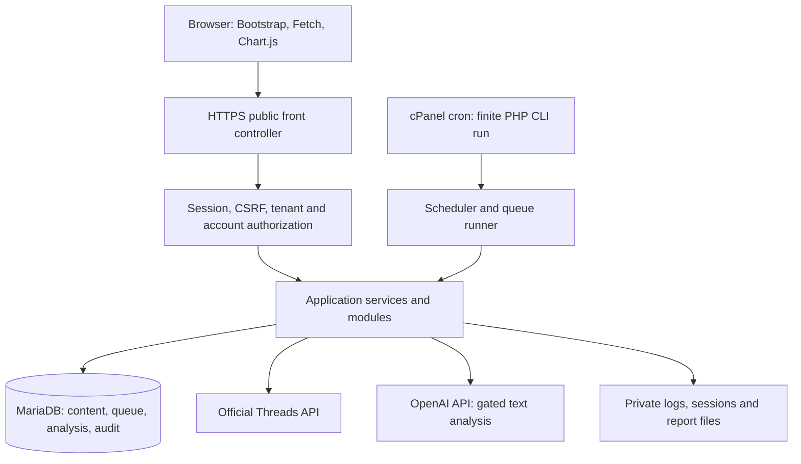

# System architecture

Status: Phase 1 foundation and Phase 2 synthetic queue/privacy operations implemented. Phase 3A research/design completed on 25 October 2026 without application changes. Providers, collection, analysis and reporting remain future design.

The dated [Phase 3A integration design](PHASE3A_INTEGRATION_DESIGN.md) refines the future provider contracts: one bounded network request per invocation, explicit account/source fences, provider request reservations and real-data purge/restore extensions. None is implemented by this document. Its [decision report](PHASE3A_DECISION_REPORT.md) constrains future purposes to an eligible owned-discussion use; public replier enrichment remains disabled. Phase 3B requires separate approval.
Planning date: 24 October 2026.

Phase 2 implementation decisions (25 October 2026): the explicit composition root now includes Queue and Privacy. Claim/publication lock organization, synthetic scope and job in order; ordinary leases last 90 seconds and the cooperative runner defaults to 25 seconds/96 MiB. Each invocation names its organization; an hourly coalescing schedule dispatches retention at priority 100. Implemented states are ready/running/retry_wait/succeeded/failed/cancelled. A synthetic-workload tombstone preserves administrator access, increments the existing organization privacy epoch/data version and mirrors the scope epoch. Private synthetic artifacts are inventoried before writing; deletion intents are signed and stored independently. Account/source checks, provider blocked/budget/request handling and fair automatic multi-tenant coordination await those modules. The broader diagram/contracts below remain proposals where they exceed these capabilities. Exact behavior: [QUEUE_ARCHITECTURE.md](QUEUE_ARCHITECTURE.md), [PRIVACY_RETENTION.md](PRIVACY_RETENTION.md), [PHASE2_COMPLETION_REPORT.md](PHASE2_COMPLETION_REPORT.md).

## 1. Architectural decision

Use a modular monolith: one native PHP application, one MariaDB database, a web entry point, and bounded CLI commands. HTTP and CLI invoke the same application services and repositories. This matches ordinary cPanel hosting and keeps transactions, authorization, evidence lineage and deletion within a single deployment.

Phase 1 implements `Identity`, `Access` and the health/audit/maintenance subset of `Operations`, plus shared infrastructure. It serves one administrator and one organization without invitation or organization-management flows. The diagram and remaining module contracts describe the eventual system, not currently available features. See [PHASE1_COMPLETION_REPORT.md](PHASE1_COMPLETION_REPORT.md) for the actual inventory and [LOCAL_SETUP.md](LOCAL_SETUP.md) for executable commands.



The browser never contacts provider APIs or receives credentials. Provider work runs in CLI jobs, except for the short server-side OAuth code exchange. OAuth callbacks have a strict request budget and reconnect recovery. Web actions enqueue work and return HTTP 202 plus an authorized status URL; Fetch polls with backoff. Dashboards read retained results and aggregates without waiting for providers.

## 2. Layering and module contracts

- **HTTP layer:** explicit route definitions, controllers, request validation, middleware and escaped server-rendered templates. Use session-based same-origin Fetch endpoints; no frontend bearer token store.
- **Application layer:** use-case services enforce membership, role, account grants, scope eligibility and policy state. Transactions are owned here; controllers stay thin.
- **Domain layer:** typed value objects, status transitions, metric definitions, analysis taxonomy and deletion rules. It contains no global session, HTTP or filesystem access.
- **Infrastructure layer:** PDO repositories, cURL clients, token encryption, clock, queue implementation, private file store and logging. External clients implement small interfaces so tests use fixtures.

Use constructor injection and a small explicit composition root; avoid a global service locator. Modules communicate through application interfaces and database-backed job dispatch. A data update and required next job are committed in one transaction; do not rely on an in-memory event bus surviving process exit. Web and CLI contexts both carry explicit organization/account scope. There is no unscoped repository default.

| Module | Main application services | Dependencies |
| --- | --- | --- |
| Identity | Authenticate sole administrator, change password, revoke sessions | PDO, password hashing, session service, audit |
| Access | Resolve organization context, authorize account/action, manage membership | Identity, memberships, account grants |
| Threads | Begin/complete connection, refresh token, resolve capabilities | Access, crypto, cURL, policy configuration |
| Collection | Plan import, fetch page, reconcile source, checkpoint | Threads, content repositories, queue |
| Audience | Resolve author observation, retrieve permitted profile sample | Collection, optional discovery, provenance |
| Analysis | Plan run, reserve budget, classify item, validate and persist result | Evidence, OpenAI client, policy gate, queue |
| Analytics | Define scope, compute chunks, publish aggregate version | Retained evidence and valid current results |
| Reporting | Snapshot scope, render HTML, stream CSV, authorize download | Analytics, report evidence, private files |
| Privacy | Block scope, record deletion, purge chunks, expire content | All attributable stores, queue fences, audit |
| Operations | Dispatch due tasks, claim/retry jobs, health and safe logs | Queue, provider budgets, migration registry |

## 3. Proposed directory structure

The following tree is a future layout. Phase 1 creates only the foundation subset; it uses a native `tests/run.php` runner and private PHP configuration, without a dotenv parser or empty future module scaffolding. Actual paths are in the completion report.

```text
threads-audience-intelligence/
  AGENTS.md
  docs/                         planning, decisions and operational runbooks
  app/
    Bootstrap/                  composition root, autoloader, environment validation
    Shared/
      Domain/                   identifiers, clocks, common exceptions
      Application/              scoped context and transaction interfaces
      Infrastructure/           database, HTTP, crypto, logging, file store
      Http/                     routing, middleware, responses
    Modules/
      Identity/
      Access/
      Threads/
      Collection/
      Audience/
      Analysis/
      Analytics/
      Reporting/
      Privacy/
      Operations/
        [each module: Domain/, Application/, Infrastructure/, Http/ where needed]
  config/                       versioned non-secret defaults and environment loader
  database/
    migrations/                 ordered forward migrations and checksums
    fixtures/                   synthetic test fixtures only
  resources/
    views/                      PHP templates, no secrets or business rules
    analysis/                   reviewed prompt templates, schema and taxonomy versions
  public/                       sole web document root
    index.php
    .htaccess
    assets/
      css/
      js/
      vendor/                   reviewed pinned Bootstrap and Chart.js assets
  bin/                          CLI entry points; never exposed by web root
  tests/
    Unit/
    Integration/
    Contract/
    Acceptance/
    fixtures/                   sanitized provider examples and synthetic text
  storage/                      untracked private runtime directories
    logs/
    sessions/
    reports/
    tmp/
    locks/
  .env.example                  names/placeholders only if a dotenv parser is approved
  .gitignore                    secrets, runtime data, local config and exports excluded
```

Production uses a release directory and shared private configuration/storage as described in [DEPLOYMENT_PLAN.md](DEPLOYMENT_PLAN.md). Default secret loading is a restricted PHP configuration file outside the release/web root or real process environment; do not implement an ad hoc dotenv parser. The `.env.example` entry is conditional, not a planned dependency. Tests can start with a native PHP runner; any later dependency addition is a reviewed decision.

## 4. Request and evidence lifecycle

1. Authenticate local user; resolve active organization from membership, not a request-supplied organization ID alone.
2. Authorize the specific connected account and requested action. Validate post ownership, requested time range, feature capability and quotas.
3. Persist an import run plus its first job in a single transaction. Store requested range, retrieval mode, grant snapshot and requester.
4. A worker imports one bounded page. Normalize fields into approved columns, attach provenance and author observations, upsert by remote object ID, update content hash/version, then advance checkpoint and enqueue continuation atomically.
5. Changed text/context invalidates dependent analysis and aggregates. Missing optional fields remain absent; they do not acquire fabricated defaults. Profile discovery is a separate optional job with its own gate.
6. Analysis jobs use an immutable input fingerprint over selected evidence versions, context, stance target, model, prompt, taxonomy and schema. Reuse an existing valid result for an identical fingerprint.
7. Schema and evidence validation precede result publication. Refusal/incomplete/unsafe/unknown outputs become explicit statuses. Reports only include currently authorized, unexpired source evidence.
8. Aggregate jobs calculate chunks and publish a complete version by swapping an active-version pointer. Users see the previous completed version while rebuilding, with a stale badge. Deletion blocks affected reads immediately, even before rebuild.

Each source carries a collection time, current content hash, source version, expiry, permission/provenance reference, and visibility state. Reports carry exact scope, evidence version, model versions, denominators and an expiry no later than their evidence. An edited source creates a new current version and invalidates older interpretations; do not retain historical raw bodies indefinitely merely for reproducibility.

## 5. Background processing architecture

### 5.1 Finite runner and budgets

Cron starts a scheduler/worker every minute if supported by the host. Each invocation acquires an exclusive local process lock as an efficiency guard, dispatches a bounded set of due tasks, claims small work units, then exits. The database claim protocol is the correctness boundary even if a manual runner or second process bypasses the file lock.

Conservative initial values: 25-second wall-clock deadline, 96M memory soft ceiling, 3-second connection timeout, maximum 20-second outbound request total timeout, and at least 4 seconds reserved for persistence/cleanup. Check remaining time before each claim/call; only launch a call when its timeout plus cleanup fits. If less time remains, leave work ready for the next cron. One provider call per invocation initially; local purge/aggregation chunks may use the remaining budget. No `set_time_limit(0)`, daemon, long sleep or persistent loop.

An import page begins at 25 records, with a response byte cap (initially 1 MiB) and total decoded-input budget; reduce page size after oversize/near-memory responses. A classification starts at one reply plus bounded context (initially 12 KiB total text) with a separate bounded output/response cap. Items exceeding limits are explicitly truncated with disclosed coverage or skipped for review, never silently treated as fully analyzed. Invalid/truncated transport JSON is retried in a smaller unit, not persisted as valid evidence. Measure actual overhead before increasing caps.

### 5.2 Job state machine and claim protocol

States: `ready`, `running`, `retry_wait`, `blocked`, `succeeded`, `failed`, `cancelled`. A continuation is a new ready job; a completed chunk can succeed while its parent run remains active.

1. Select a small ordered set of due candidate IDs using the dispatch index.
2. Atomically update one candidate from ready/due retry state to running with a fresh random lease token, incremented attempt and claim generation, database-clock lease expiry (initially 90 seconds), and worker identifier. A conditional update with affected-row checking prevents two claimants winning. Re-read by ID and lease token; never trust the earlier selection alone.
3. Commit the claim before network work. Never hold row locks or transactions across API calls. Validate grant, deletion epoch, account state, budget and source versions before the call.
4. Persist results/checkpoint/continuation in a short transaction. Lock the relevant scope state and job row, verify token, generation, unexpired lease, unchanged deletion epoch and allowed account state, and then perform writes and mark success. Deletion obtains the same scope lock. Losing/expired workers discard results and cannot publish or advance cursors.
5. Recover expired leases through a conditional token/generation-checked transition to retry or failure. Recovery consumes the same finite attempt allowance; a killed process cannot retry forever. A recovery race must not reset an already renewed claim.

No row-lock behavior beyond transactional conditional updates is required; SKIP LOCKED is an optional later optimization after compatibility tests, not a baseline assumption. DB timestamps are authoritative for leases. Workers must not share PDO connections across concurrent work.

### 5.3 Duplicate prevention and exactly-once limits

- Every logical dispatch has a unique organization-scoped idempotency key. Scheduled tasks use a unique task ID plus UTC time slot; dispatch and slot advance are one transaction.
- Source imports have unique remote IDs within their defined account namespace. Page writes, cursor advance and next-job creation are atomic. Replaying a page changes no counts.
- Analysis has a unique evidence/configuration fingerprint. Requests for the same input reuse the same analysis item; completion uses lease fencing and a unique result key.
- Report/aggregate versions publish once through a conditional active pointer. Private file generation uses random temporary files plus an atomic rename; an orphan cleanup job handles crashes before DB publication.
- Delivery is **at least once**. Local publication is idempotent; an external request can execute twice after an ambiguous timeout/crash. Never promise exactly-once OpenAI billing. Keep attempts and budget reservations for unknown outcomes and stop automatic retries at the configured threshold.

### 5.4 Job catalog and recovery

| Job | Bounded unit / checkpoint | Recovery |
| --- | --- | --- |
| Import owned posts | One provider page / opaque cursor and import pass | Replay page; restart invalid cursor with bounded overlap |
| Import replies/conversation | One root's page / mode, cursor and pass | Same ID upserts; no deletion inference from missing page |
| Refresh token | One account / token generation | Per-account lock; compare-and-swap generation; reconnect if invalid |
| Optional profile/public-post sample | One verified discovery page / observation and cursor | Capability-aware block; reply analytics continues |
| Analyze reply/profile sample | One bounded input / fingerprint | Reuse valid result; bounded retry or review |
| Aggregate scope | One ID range / aggregate version and high watermark | Resume chunk, publish only after completion |
| Generate report | One report chunk / last evidence ID and temp artifact | Resume or rebuild private artifact safely |
| Retention/deletion | Small dependent-row batch / target scope and phase | Immediate tombstone, resumable physical purge |
| Reconcile source visibility | Small verified object batch / last object ID | Mark unavailable only with explicit provider evidence |

Retries: exponential schedule with jitter (initial proposal: 1, 5, 15, 60 and 240 minutes), maximum five automatic execution attempts. Respect a later provider retry time. Transient transport/5xx errors retry; schema/invalid fields need correction; revoked permissions, expired credentials and budget exhaustion block; source confirmed deleted cancels dependent work and initiates purge. Rate-limit deferrals before a provider call do not count as failed executions, but must have an expiry/alert threshold. Manual retry is audited and creates a new dispatch linked to the prior failure.

Cancellation/deletion is rechecked at claim, before outbound calls and before commit. A remote call already in flight cannot be recalled; do not store its response after access is withdrawn. Network calls happen outside transactions; stale workers can consume a request but cannot restore deleted data.

## 6. Security architecture

| Boundary | Required control |
| --- | --- |
| Local identity | `password_hash`/`password_verify`, cost measured on host, Argon2id if supported else tuned bcrypt; no default password; generic errors and DB-backed login throttles |
| Sessions | HTTPS; host-only Secure, HttpOnly, SameSite=Lax cookies; strict session mode, cookies only; regenerate ID at login/privilege change; 30-minute idle and 12-hour absolute limits; server-side revocation |
| Organization/account | Deny by default; every route/job/report resolves membership and explicit account grant; no cross-tenant author cache; owners manage grants, analysts import/analyze, viewers read granted output |
| CSRF and OAuth | Random per-session CSRF tokens for mutations, constant-time validation, Origin checks as defense in depth; one-time OAuth state for callback; no general mutation by GET |
| Secrets | Sodium authenticated encryption for tokens with random nonce, key ID and associated scope; master keys outside DB/web root; environment-separated keys; key rotation and tested recovery |
| SQL | Native PDO prepared statements, emulation off, exception mode; identifiers/order clauses selected from allowlists; bounded pagination and query time budgets |
| Rendering | Escape all text including AI output; use DOM `textContent`; reject executable URLs; no untrusted HTML rendering; CSP, frame protection, nosniff and controlled referrers |
| Provider transport | TLS verification, fixed allowlisted HTTPS hosts/paths, no arbitrary URL fetching or cross-host redirects; private IP/SSRF protection if any URL fetch is ever added |
| Logs | Structured redacted logs with correlation IDs and safe codes; scrub query tokens, cookies, Authorization, client secrets, OAuth codes/state, credentials and text bodies |
| Files | Private sessions/reports/tmp/logs; generated random filenames, traversal-safe IDs, authenticated streaming downloads, file expiry; CSV formula-injection neutralization |
| AI boundary | Minimum text, opaque IDs, allowlisted schema and labels, evidence validation, no tools; content cannot override instructions or authorize actions |
| Deletion | Scope tombstone and epoch fence before purge; derivative invalidation, cancellation, suppression, backups ledger and auditable completion |

Bootstrap the first installation administrator through CLI. Installation administration manages health and users but does not automatically grant reading every organization's content; support access must be explicit, time-bound and audited. Invitation/reset tokens are random, hashed, short-lived and single-use. Invitations can be copied by an authorized owner; no email delivery dependency is assumed. If password reset delivery is added, its channel must be verified and must not disclose account existence. Changing passwords revokes other sessions.

Rate-limit state and audit metadata must themselves have retention and cardinality bounds. Do not store full IP addresses indefinitely. Session locks are released promptly after context validation so polling and OAuth do not block each other.

## 7. Deletion and retention consistency

Privacy service first marks the account/subject/content inaccessible and increments the applicable deletion epoch while holding the shared scope lock. It cancels matching jobs and records minimal suppression references so later replay cannot reimport the same deleted subject/content without an explicitly allowed new authorization. Organization/account deletion overrides narrower grants.

Every content/author deletion also increments its account privacy epoch so cached account metrics and reports fail closed, even if the affected source is only one reply. Source changes, successful analyses and effective corrections increment account data_version and mark aggregates dirty. An old aggregate can be shown as stale after ordinary additions; a privacy-invalid aggregate cannot be displayed.

Physical purge visits report files/evidence, aggregates, corrections/analysis evidence/results, provider request metadata, topic links, profile/public-post samples, replies/posts, author identifiers and credentials in bounded batches. Privacy epochs also invalidate active report and aggregate versions immediately; exclude them from reads until rebuilt. Retention uses the same service as user deletion. Source removals propagate to all derived results; never retain a quoted snippet after its source expires.

Deletion status is `requested`, `blocked_access`, `purging`, `primary_complete`, `backup_expiry_pending`, `complete` or `failed`. Final completion includes verified derivative removal and backup expiry. Suppression identifiers are keyed hashes, not raw usernames, and are still protected personal-data controls with a documented limited purpose. Their retention must satisfy the verified policy. Backup restore replays the deletion ledger before enabling web/cron access.

## 8. Dashboard and report structure

Navigation: Overview, Posts, Discussions, Observed Audience, Topics, Reports, Jobs, Connections, Settings. Owners additionally see Users/Access, Privacy and Operations. Permissions are enforced server-side even for hidden navigation items.

| Screen | Content and interaction |
| --- | --- |
| Overview | Imported posts/replies, stable-ID authors and provisional handles separately, analysis coverage, sentiment distribution, activity series, recurring topics, freshness and blocked jobs |
| Posts | Paginated imported posts, date/account filters, import scope/status, retained replies vs optional official counts; select authorized posts for import/analysis |
| Discussion detail | Root/parent context, accessible replies, sentiment/stance/style, evidence excerpt, uncertainty and correction controls; disclosure of missing/partial context |
| Observed audience | Observed activity counts and identity quality; permitted self-described profile statements only; no sensitive trait scores or unsupported dossiers |
| Topics | Multi-label reply topics with counts/denominators and evidence; optional public-post sample in a separate labeled view |
| Reports | Scope, date/timezone, retrieval coverage, model/prompt version, methodology, findings with evidence, limitations, private HTML/CSV download and expiry |
| Jobs | Parent run and chunk status, last checkpoint, attempts, next retry, safe errors, cancellation and authorized manual retry |
| Connections | Granted vs requested capabilities, token expiry, refresh status, reconnect/disconnect and optional-feature state |
| Operations/privacy | Last cron success, oldest ready job, failures, budgets, storage, retention policy, deletion progress, audit events |

Use Chart.js for time series, sentiment bars and topic bars, with accessible HTML tables. Filters persist via safe URL parameters and server validation. Paginate large reply/author lists; do not download an entire corpus to JavaScript. Empty, unavailable, partial, stale and zero are distinct UI states. Chart totals and tables use the same scoped metric service. No PDF dependency is proposed: HTML with print styling and CSV are sufficient for the first release.

## 9. Observability and technical risks

Capture request/job correlation ID, module, safe provider request ID, result code, duration, memory peak, counts and next retry. Record cron start/end/exit, oldest due work, failure rate, permission failures, deletion age, per-run token usage and budget state. Health output exposes no configuration secrets. Configure an administrator-visible stale-cron warning after three missed expected intervals and alerts for deletion delay/budget exhaustion. Email alerts are optional future integration, not a dependency.

Principal constraints are incomplete API coverage, approval delays, changing provider contracts, multilingual/sarcastic text, provisional author identity, shared-host latency, 128M memory, 30-second execution, cron downtime, disk growth, repeated external billing after ambiguous failures, and key loss. Mitigations are capability gates, small resumable units, evidence-linked abstaining analysis, indexed bounded queries, cost reservations, explicit uncertainty, finite retention, restore exercises and independent key backups. If reliable analysis cannot finish within a single permitted call budget, lower input/output size or disable it until an approved architectural change is available.
